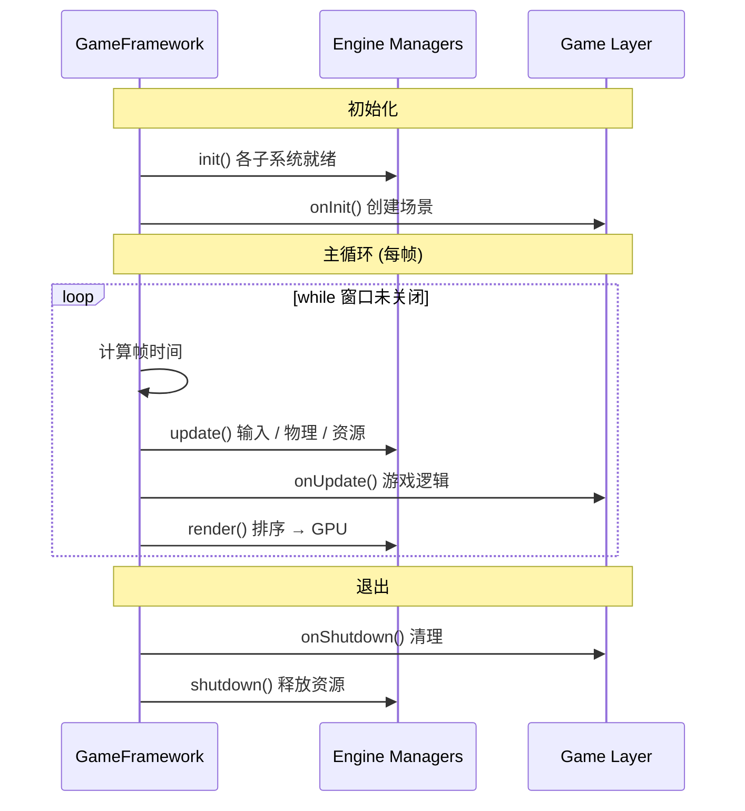
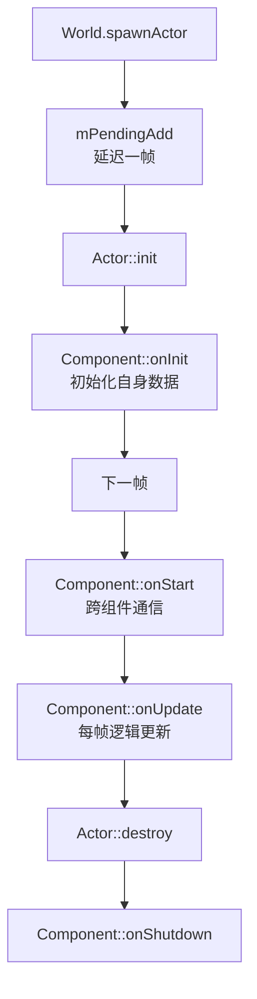
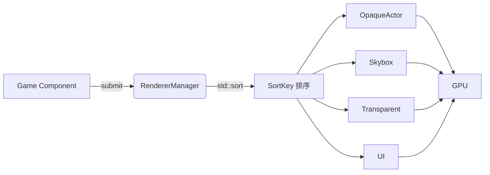
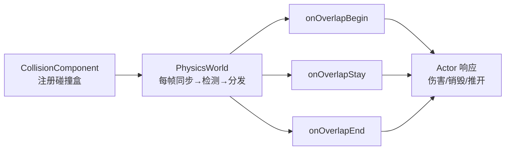
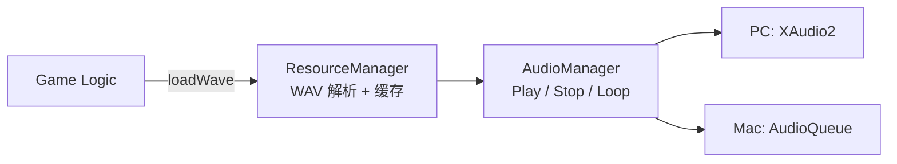
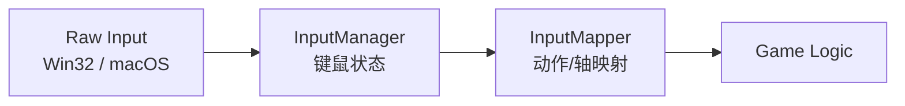
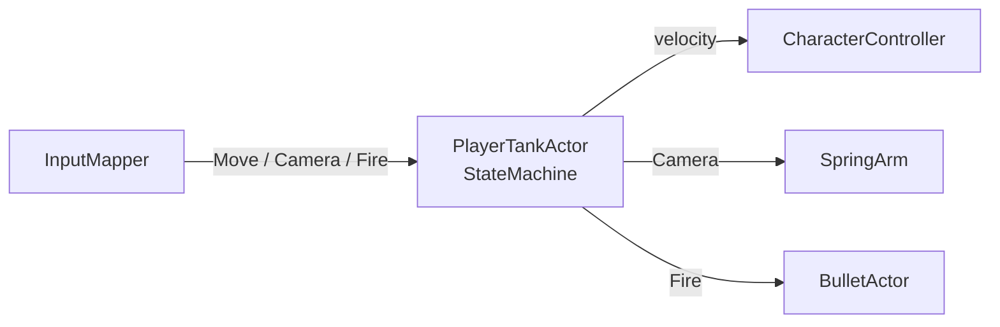
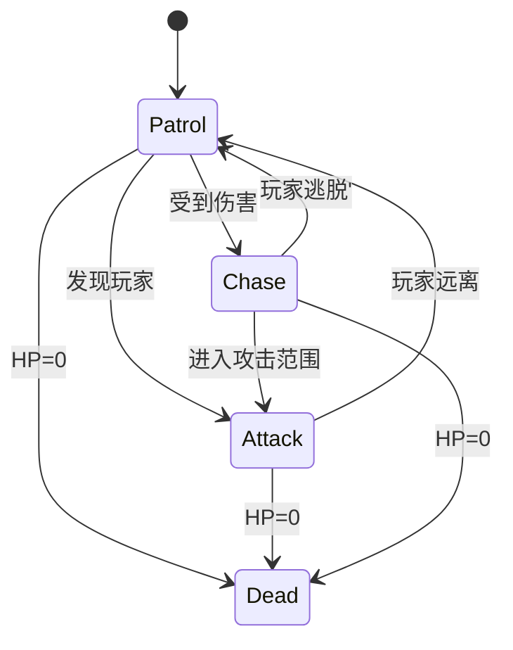

# 3D Tank Game Technical Design Document

## 目录
- [3D Tank Game Technical Design Document](#3d-tank-game-technical-design-document)
  - [目录](#目录)
  - [1. 概述](#1-概述)
  - [2. 框架概述](#2-框架概述)
    - [框架生命周期](#框架生命周期)
    - [组件式设计](#组件式设计)
  - [3. 渲染](#3-渲染)
  - [4. 物理](#4-物理)
  - [5. 声音](#5-声音)
  - [6. 玩法实现](#6-玩法实现)
    - [输入系统](#输入系统)
    - [玩家坦克设计](#玩家坦克设计)
    - [状态机和敌人 AI 设计](#状态机和敌人-ai-设计)
    - [Log 系统](#log-系统)

## 1. 概述

本项目实现了一个跨平台 3D 坦克对战游戏，基于团队自研的轻量级游戏框架进行开发。项目从底层图形 API 到上层 Gameplay 逻辑均由团队自主实现，未依赖 Unity、Unreal 等商业游戏引擎。

当前项目已支持 Windows PC 与 macOS 双平台运行，展示了团队在渲染管线、碰撞检测、Gameplay 架构、跨平台适配和项目工程化方面的完整技术能力。

第三方库方面，项目使用 GLM 作为数学库，使用 ImGui 作为调试 UI 与简单 2D UI 绘制方案。

## 2. 框架概述
本项目基于自研轻量级游戏框架搭建，框架分为引擎层与游戏逻辑层，实现了主循环驱动，场景管理到游戏逻辑更新的完整链路。
<!-- 
 -->

### 框架生命周期

框架的完整生命周期分为 **初始化 → 主循环 → 退出** 三个阶段，由 GameFramework
统一驱动：

**关键设计点：**
1. **GameFramework** 作为引擎入口，不暴露平台细节，上层 Game 只需实现 IGame 接口即可接入。

2. **Manager 体系** 按依赖顺序初始化（先 Input 再 Render 再 Audio 再 Resource），逆序退出，保证资源依赖正确释放。

3. **World** 作为场景中枢，统一管理所有 Actor 的创建销毁与帧更新，物理碰撞检测在 tickAllActor 内自动完成。

4. **GameTimerManager** 作为游戏中的定时器，给游戏逻辑提供定时触发逻辑。

5. **ResourceManager** 作为游戏中的资源加载类，给上层逻辑提供资源的加载和复用。

### 组件式设计

游戏采用 Actor-Component 架构，Actor 作为组件容器，Component 作为可复用的
逻辑插件，由 World 统一驱动生命周期：

**关键设计点**
1. **生命周期设计**：onInit 和 onStart 间隔一帧，保证所有 Component 构造
   完毕后才进入 onStart，Component 之间可安全地通过
   getComponent<T>() 互相引用。

2. **Transform 层级**：Actor 自带 Transform 支持父子嵌套，重设父节点时
   自动保持世界空间位置不变，内置循环引用检测。

3. **碰撞事件路由**：子 Actor的碰撞事件自动向上路由到根
   Actor，简化复合实体的碰撞响应。

4. **延迟销毁**：Actor 的创建和销毁均延迟到帧末批量处理，避免迭代中修改容器。

## 3. 渲染

渲染模块以 RendererManager 为核心，向上层 Game 提供统一的渲染接口，
通过提交-排序-绘制三段管线将场景对象高效输出至 GPU。

渲染数据流如下，Game 层 Component 将 RenderResource 提交到
RendererManager，经 SortKey 一次排序后按通道分组，最后提交 GPU：

**关键设计点**
1. **RenderPass**：用一个 64 位整数的高 8 位编码 RenderPass、中 24位编码摄像机距离，一次 std::sort 完成不透明、天空盒、透明、UI 四个通道的正确排序。

2. **Blinn-Phong 光照**：扩展常量缓冲区上传法线、摄像机位置和方向光，
   Shader 中计算环境光 + 漫反射 + 高光。

3. **调试绘制**：封装 DebugDrawLine, DebugDrawSphere 接口，
   支持碰撞体可视化和物体位置点绘制。

## 4. 物理

物理模块提供基于 AABB 的碰撞检测、重叠事件分发和角色移动控制，
整体流程如下：

**关键设计点**
1. **AABB 碰撞盒**： 编写AABB 数据结构，支持基础的包围盒相交检测。

2. **CollisionComponent** 每个 CollisionComponent 持有局部 AABB，通过 Transform 信息更新世界空间 AABB，支持物体移动、缩放后的碰撞体同步。

3. **重叠事件体系**：PhysicsWorld 每帧收集全部碰撞体进行 AABB 相交检测，
   对比前后帧的碰撞对变化，自动分发 Begin / Stay / End 三种重叠事件

4. **角色控制器**：CharacterControllerComponent 实现速度移动 →
   AABB 穿透检测 → 最小穿透轴推开的运动学控制，并支持重力模拟和地面射线检测

## 5. 声音

音频系统提供跨平台的音效加载、缓存和播放能力，整体流程如下：

**关键设计点**
1. **WAV 加载与缓存**：ResourceManager 解析标准 WAV 格式，首次加载后以
   shared_ptr 缓存 PCM 数据，后续复用避免重复解析

3. **播放控制**：支持单次播放和循环播放

## 6. 玩法实现
游戏基于状态机构建玩家坦克和敌人 AI，通过基类 TankActor 派生
PlayerTankActor 和 EnemyTankActor，实现完整的坦克移动对战逻辑。

### 输入系统

输入系统采用四层抽象，将平台原始输入转换为语义化动作供 Gameplay 使用：

**关键设计点**
1. **动作抽象**：将 W/A/S/D、鼠标等原始按键映射为 MoveForward / Fire /
   Jump 等 GameAction，游戏逻辑不感知具体键位。

2. **轴映射**：支持正负键绑定（如 W/S 映射到 MoveVertical 轴），带
   死区和灵敏度配置，平滑插值输出。

3. **输入缓冲**：isActionActivatedWithinBuffer 提供时间窗口内的输入
   缓冲，改善手感。

### 玩家坦克设计

**关键设计点**
1. **输入驱动状态机**：根据 Move 输入在 Idle / Moving 状态间切换，Fire动作在除死亡状态下的任意状态均可触发射击。

2. **弹簧摇臂相机**：SpringArmComponent 接收鼠标输入控制 yaw/pitch，支持自动回正和平滑阻尼，为 Camera 提供第三人称视角。

3. **射击流程**：从炮管口获取枪口位置，沿相机方向生成 BulletActor，播放射击音效并触发相机震动。

4. **受击感受**：构建了玩家血条和受击音效和受击时屏幕闪烁，增强了玩家与敌人坦克对抗的感觉。
    
### 状态机和敌人 AI 设计
敌人坦克基于有限状态机实现自主行为：

**关键设计点**
1. **Patrol 巡逻**：随机选择巡逻目标，每 3 秒通过 GameTimerManager 刷新，以半速移动。

2. **Chase 追逐**：受到伤害后全速追击，进入攻击范围后切回 Attack，脱离追逐范围后放弃追踪。

3. **Attack 攻击**：每 2 秒向玩家发射子弹，持续靠近至攻击距离，枪管自动瞄准玩家方向。

4. **Dead 死亡**：HP 归零后播放死亡音效并销毁自身。

### Log 系统
LogSystem用于为引擎和游戏逻辑模块提供统一的运行时日志记录与调试信息查看机制。该系统主要用于在开发和调试阶段记录程序运行状态、错误信息和调试数据，帮助开发人员快速定位问题。

系统提供类似UE_LOG的宏接口，包括LOG_INFO、LOG_WARN和LOG_ERROR。日志宏支持printf风格的格式化字符串和可变参数输入，使开发人员能够在单次调用中输出包含多种数据类型和多个参数的格式化日志信息。

为避免短时间内大量日志输出影响运行时性能，系统提供每帧最大日志数量限制机制，当单帧日志数量超过限制时，后续日志将被忽略。同时，系统支持在运行时全局启用或禁用日志输出，方便开发人员暂停日志收集。
**关键设计点**
1. **分区日志**：支持按模块（StateMachine、Gameplayer 等）划分 Channel，每个 Channel 独立控制输出等级（Info / Warning / Error）。

2. **ImGui 可视化**：LogSystemImGuiView 提供实时日志面板，支持按 Channel分页查看、按等级过滤、导出等功能。